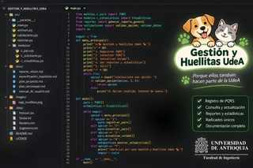

# 🐾 Gestión y Huellitas UdeA



[Ver logo institucional](images/logo_huellitas.svg)

**Gestor de PQRS para la atención veterinaria de perros y gatos en la Universidad de Antioquia.**

Proyecto integrador del curso Algoritmia y Programación, período 2026-2, desarrollado en Python para apoyar el registro, consulta y seguimiento de Peticiones, Quejas, Reclamos y Sugerencias (PQRS).

> **Estado: desarrollo en curso en la rama `desarrollo`.** Ya se incorporaron los módulos de validaciones, archivos, reportes y menú principal. Las 16 pruebas automatizadas pasan en Ubuntu y Windows con Python 3.12. También se corrigieron los mensajes cuando un registro o cambio de estado se guarda y falla la generación del TXT. Aún falta la prueba de aceptación del equipo y validar los documentos y actas antes de integrar los cambios a `main`.

## Equipo de trabajo

| Integrante | Programa académico | Rol según el acta |
|---|---|---|
| José Miguel López Doria | Ingeniería Industrial — UdeA | Programador 1 |
| Juliana Rivera Sarge | Ingeniería Industrial — UdeA | Diseñadora 1 |
| Víctor Silgado | Ingeniería Industrial — UdeA | Diseñador |
| Juan Pablo Quintero Gómez | Ingeniería Industrial — UdeA | Programador |
| Sebastián Cardona | Ingeniería Industrial — UdeA | Diseñador e investigador |

## Descripción

El sistema gestiona PQRS recibidas por distintos canales. Cada tipo de solicitud mantiene un consecutivo independiente y almacena la información del solicitante, la petición, la mascota, el campus, el estado y las fechas de gestión.

El programa utiliza cuatro archivos planos independientes, genera comprobantes TXT y calcula indicadores de seguimiento.

## Funcionalidades desarrolladas en la rama `desarrollo`

- Registro de PQRS con validaciones de datos.
- Consecutivo independiente para Peticiones, Quejas, Reclamos y Sugerencias.
- Consulta por tipo y consecutivo, además de listado general.
- Cambio de estado con el flujo Registrada → En proceso → Solucionada.
- Generación de radicados TXT con marco de 120 caracteres por línea.
- Promedio de días de respuesta y cinco estadísticas complementarias.

Estas funcionalidades se encuentran en proceso de prueba y revisión.

## Documentación

- [Reporte de visión](docs/reporte_vision.md)
- [Especificación de requisitos](docs/especificacion_requisitos.md)
- [Plan de proyecto](docs/plan_proyecto.md)
- [Plan de versionado](docs/plan_versionado.md)
- [Manual de usuario](docs/manual_de_usuario.md)
- [Matriz de cumplimiento de la rúbrica](docs/matriz_cumplimiento.md)
- [Acta única del equipo (PDF público, sin firmas ni identificaciones)](docs/actas/Acta_de_entendimiento_publica.pdf)
- [Algoritmo y diagramas de flujo](docs/algoritmo.md)
- [Checklist de pruebas de aceptación](docs/pruebas_aceptacion.md)
- [Guía de sustentación técnica y preguntas sobre el código](docs/guia_sustentacion_tecnica.md)

## Estructura del repositorio

```text
gestion_y_huellitas_udea/
├── src/       # Código fuente Python
├── tests/     # Pruebas automatizadas
├── docs/      # Documentación, actas y manual
├── images/    # Logo y recursos gráficos
├── data/      # Archivos planos generados localmente
├── README.md
└── LICENSE
```

## Ejecución y pruebas

Desde la carpeta raíz del repositorio:

```bash
python -m unittest discover -s tests -v
python src/main.py
```

La primera ejecución crea los cuatro archivos de datos si no existen. Los archivos de datos y radicados generados se excluyen del control de versiones para evitar publicar datos personales.

## Licencia

El proyecto se distribuye bajo la licencia **MIT**. Consulta el archivo [LICENSE](LICENSE).

## Contexto académico

- **Curso:** Algoritmia y Programación
- **Programa:** Ingeniería Industrial
- **Institución:** Universidad de Antioquia
- **Período:** 2026-2
- **Docente:** Julián Andrés Castillo
