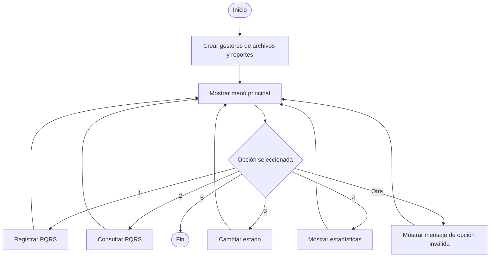
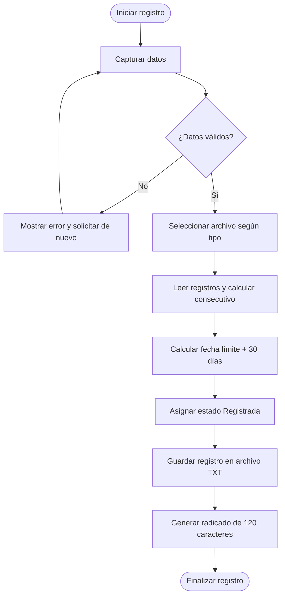
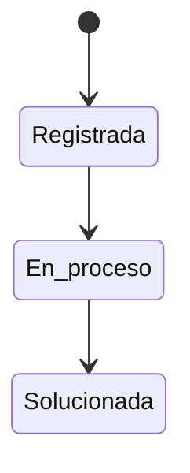

# Algoritmo del sistema — Gestión y Huellitas UdeA

## 1. Flujo general del programa

El sistema inicia mostrando un menú de consola. El administrador puede registrar una PQRS, consultar registros, actualizar el estado, revisar las estadísticas o salir.

## 2. Algoritmo de registro

1. Solicitar los datos del solicitante.
2. Validar cada dato mediante `c_validaciones`.
3. Solicitar la información de la PQRS y validar sus opciones permitidas.
4. Identificar el archivo plano según el tipo de solicitud.
5. Leer los registros existentes en ese archivo.
6. Calcular el siguiente ID como el mayor ID existente más uno; si no hay registros, iniciar en 1.
7. Calcular la fecha máxima de respuesta sumando 30 días calendario a la fecha de radicación.
8. Asignar el estado inicial Registrada y guardar la fecha y hora del registro en el sistema.
9. Guardar el registro como una línea JSON en el archivo de texto correspondiente.
10. Generar y mostrar el radicado TXT.

## 3. Archivos de almacenamiento

| Tipo de PQRS | Archivo |
|---|---|
| Petición | `data/Peticion.txt` |
| Queja | `data/Queja.txt` |
| Reclamo | `data/Reclamo.txt` |
| Sugerencia | `data/Sugerencia.txt` |

Cada archivo mantiene su propia secuencia de ID. Los datos se guardan en texto UTF-8 como registros JSON, uno por línea. Los archivos se crean automáticamente cuando el sistema necesita leer o escribir el tipo correspondiente.

## 4. Algoritmo de cambio de estado

El programa identifica la solicitud por tipo y consecutivo. Después compara el estado actual con la transición solicitada. Solo se permiten los cambios siguientes:

Cuando se cambia a Solucionada, el sistema guarda la fecha de respuesta para calcular el promedio de días de atención.

## 5. Algoritmo de generación del radicado

1. Recibir el registro consultado o recién creado.
2. Preparar el encabezado y las secciones de información.
3. Omitir la descripción detallada.
4. Mostrar N/A cuando la dirección no esté diligenciada.
5. Ajustar cada línea al ancho exterior exacto de 120 caracteres.
6. Guardar el comprobante en `data/radicados/`.

## 6. Estadísticas

El módulo `c_reportes` calcula el promedio entero de días de respuesta y cinco indicadores complementarios: cantidad por tipo de solicitud, cantidad por tipo de mascota, distribución por estado, PQRS activa más antigua y PQRS vencidas o próximas a vencer.

## 7. Clases y módulos principales

| Archivo | Clase | Responsabilidad |
|---|---|---|
| `src/main.py` | `c_main` | Menú, captura de datos e interacción con el administrador |
| `src/validaciones.py` | `c_validaciones` | Validaciones de campos y normalización de opciones |
| `src/archivos.py` | `c_archivos` | Consecutivos, lectura, escritura, consulta, estados y radicados |
| `src/reportes.py` | `c_reportes` | Cálculo de estadísticas |

El algoritmo descrito corresponde a la implementación de la rama `desarrollo`; debe mantenerse sincronizado con los cambios y las pruebas del código.
