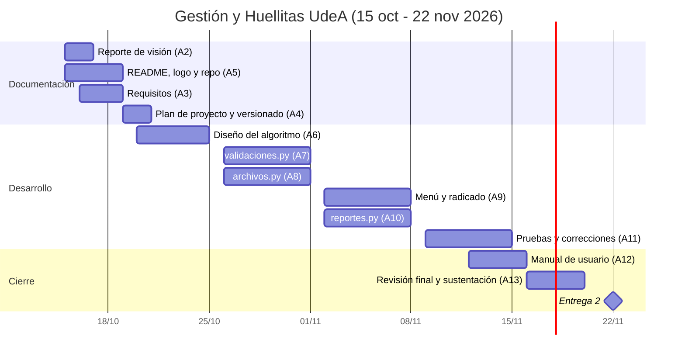

# Plan de proyecto: Gestión y Huellitas UdeA

## 1. Actividades y presupuesto

Las horas se pagan "a valor de práctica profesional" (1 SMLV 2026 = $1.750.905).
Valor hora usado: **$8.338**.

| ID | Actividad | Horas | Costo (COP) |
|---|---|---|---|
| A1 | Actas de entendimiento, colaboración y responsabilidad | 3 | $25.014 |
| A2 | Reporte de visión | 3 | $25.014 |
| A3 | Especificación de requisitos | 4 | $33.352 |
| A4 | Plan de proyecto y plan de versionado | 3 | $25.014 |
| A5 | README, logo y estructura del repositorio | 4 | $33.352 |
| A6 | Diseño del algoritmo y de las clases | 5 | $41.690 |
| A7 | Módulo `validaciones.py` | 5 | $41.690 |
| A8 | Módulo `archivos.py` | 5 | $41.690 |
| A9 | Menú, registro y radicado de 120 caracteres | 5 | $41.690 |
| A10 | Módulo `reportes.py` (6 estadísticas) | 5 | $41.690 |
| A11 | Pruebas y corrección de errores | 4 | $33.352 |
| A12 | Manual de usuario | 2 | $16.676 |
| A13 | Revisión final y preparación de la sustentación | 2 | $16.676 |
| | **Total** | **50** | **$416.900** |

## 2. Cronograma (Diagrama de Gantt)

## 3. Hitos

| Fecha | Hito |
|---|---|
| 21 oct | Documentos de la Entrega 1 corregidos y subidos |
| 25 oct | Diseño del algoritmo terminado |
| 14 nov | Programa completo y probado |
| 19 nov | Manual y revisión final listos |
| 22 nov | Entrega 2 |

## 4. Seguimiento del avance real (corte: 7 de noviembre de 2026)

Este seguimiento diferencia los documentos y módulos que ya están incorporados en la rama `desarrollo` de las actividades que aún requieren revisión del equipo. No equivale a un porcentaje de horas ejecutadas: las horas reales deben registrarse con el equipo.

| Actividad | Evidencia actual | Estado al 7 nov |
|---|---|---|
| A1. Acta única del equipo | Acta combinada recibida; copia pública PDF en `docs/actas/Acta_de_entendimiento_publica.pdf`; la copia pública omite firmas e identificaciones. Reúne entendimiento, colaboración y responsabilidades en un solo archivo | Parcial: confirmar con el docente si acepta un único documento combinado, pues la rúbrica enumera tres entregables |
| A2. Reporte de visión | `docs/reporte_vision.md` incorporado | Elaborado; pendiente revisión del equipo |
| A3. Especificación de requisitos | `docs/especificacion_requisitos.md` incorporado y actualizado con las seis estadísticas | Elaborado; pendiente validación final |
| A4. Plan de proyecto y versionado | `docs/plan_proyecto.md` y `docs/plan_versionado.md` presentes | Elaborado |
| A5. README, logo y estructura | README actualizado; logo vectorial `images/logo_huellitas.svg` agregado; faltan aprobación del equipo y perfiles individuales de habilidades | Parcial |
| A6. Diseño del algoritmo y clases | `docs/algoritmo.md` y clases `c_main`, `c_validaciones`, `c_archivos`, `c_reportes` incorporadas | Implementado; pendiente explicación y revisión del equipo |
| A7. Validaciones | `src/validaciones.py` | Implementado; pruebas automatizadas en curso |
| A8. Archivos | `src/archivos.py` | Implementado; pruebas automatizadas en curso |
| A9. Menú, registro y radicado | `src/main.py` y generación de TXT de 120 caracteres | Implementado; pendiente prueba de aceptación con el equipo |
| A10. Reportes | `src/reportes.py` y seis indicadores | Implementado; pendiente validación con casos adicionales |
| A11. Pruebas y correcciones | `tests/test_core.py` y flujo de GitHub Actions; 11 pruebas aprobadas en Ubuntu y Windows con Python 3.12 | En verificación multiplataforma |
| A12. Manual de usuario | `docs/manual_de_usuario.md` | Borrador actualizado; pendiente prueba paso a paso |
| A13. Revisión final y sustentación | Aún no hay evidencia de revisión final o ensayo de sustentación | Pendiente |

### Control de horas

Registrar las horas reales por integrante y actividad en las reuniones del equipo. La estimación total de 50 horas es la referencia del proyecto y no debe confundirse con horas ya ejecutadas.

| Integrante | Horas estimadas según distribución del equipo | Horas reales registradas |
|---|---:|---:|
| José Miguel López Doria | [Acordar] | [Registrar] |
| Juliana Rivera Sarge | [Acordar] | [Registrar] |
| Víctor José Salgado Romero | [Acordar] | [Registrar] |
| Juan Pablo Quintero Gómez | [Acordar] | [Registrar] |
| Sebastián Cardona | [Acordar] | [Registrar] |

## 5. Riesgos

| Riesgo | Mitigación |
|---|---|
| Un integrante no entrega su parte | Seguimiento semanal según el Acta de Responsabilidad |
| Errores en validaciones o archivos | Pruebas con datos válidos e inválidos antes del 14 nov |
| Algún integrante no entiende el código | Cada uno explica su módulo al grupo antes de la sustentación |
