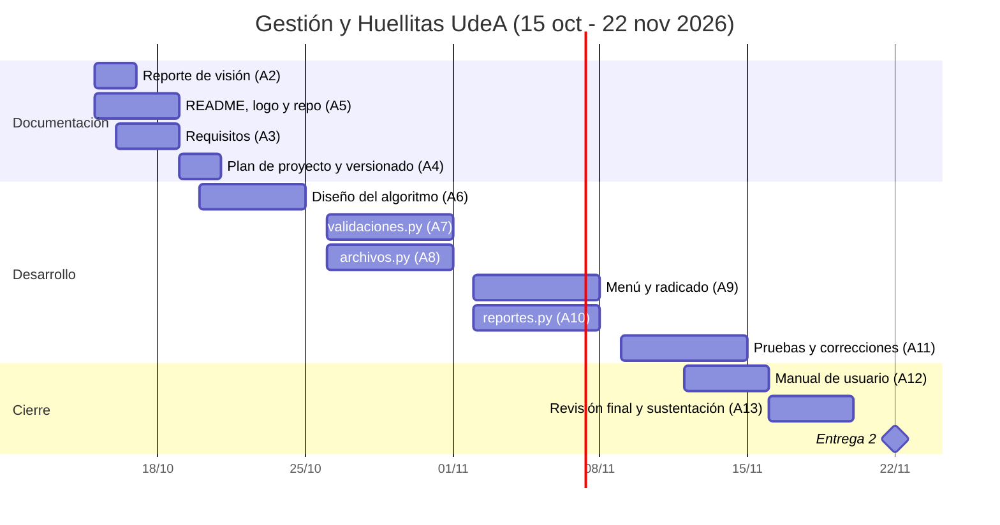

# Plan de proyecto: Gestión y Huellitas UdeA

## 1. Actividades y presupuesto

Las horas se pagan "a valor de práctica profesional" (1 SMLV 2026 = $1.750.905).
Valor hora usado: **$8.338**.

| ID | Actividad | Horas | Costo (COP) |
|---|---|---|---|
| A1 | Actas de entendimiento, colaboración y responsabilidad | 3 | $25.014 |
| A2 | Reporte de visión | 3 | $25.014 |
| A3 | Especificación de requisitos | 4 | $33.352 |
| A4 | Plan de proyecto y plan de versionado | 3 | $25.014 |
| A5 | README, logo y estructura del repositorio | 4 | $33.352 |
| A6 | Diseño del algoritmo y de las clases | 5 | $41.690 |
| A7 | Módulo `validaciones.py` | 5 | $41.690 |
| A8 | Módulo `archivos.py` | 5 | $41.690 |
| A9 | Menú, registro y radicado de 120 caracteres | 5 | $41.690 |
| A10 | Módulo `reportes.py` (6 estadísticas) | 5 | $41.690 |
| A11 | Pruebas y corrección de errores | 4 | $33.352 |
| A12 | Manual de usuario | 2 | $16.676 |
| A13 | Revisión final y preparación de la sustentación | 2 | $16.676 |
| | **Total** | **50** | **$416.900** |

## 2. Cronograma (Diagrama de Gantt)

## 3. Hitos

| Fecha | Hito |
|---|---|
| 21 oct | Documentos de la Entrega 1 corregidos y subidos |
| 25 oct | Diseño del algoritmo terminado |
| 14 nov | Programa completo y probado |
| 19 nov | Manual y revisión final listos |
| 22 nov | Entrega 2 |

## 4. Riesgos

| Riesgo | Mitigación |
|---|---|
| Un integrante no entrega su parte | Seguimiento semanal según el Acta de Responsabilidad |
| Errores en validaciones o archivos | Pruebas con datos válidos e inválidos antes del 14 nov |
| Algún integrante no entiende el código | Cada uno explica su módulo al grupo antes de la sustentación |
